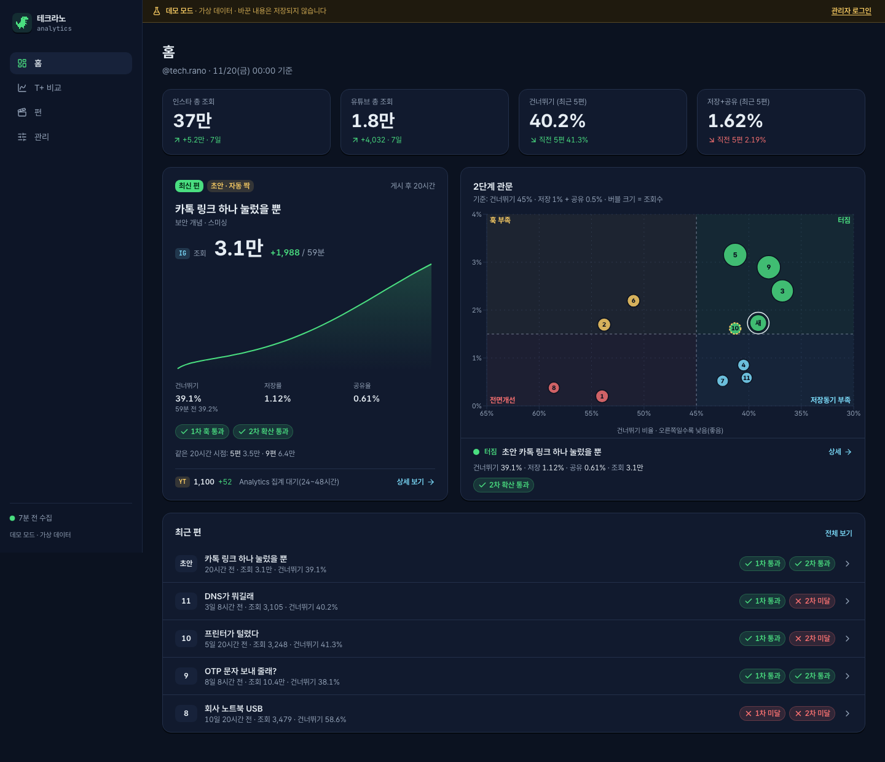
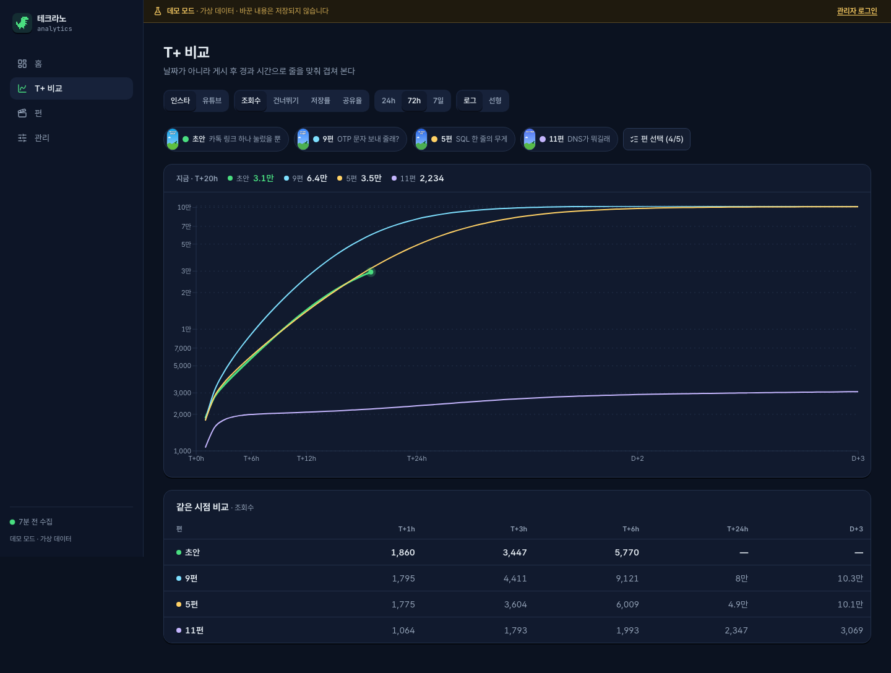
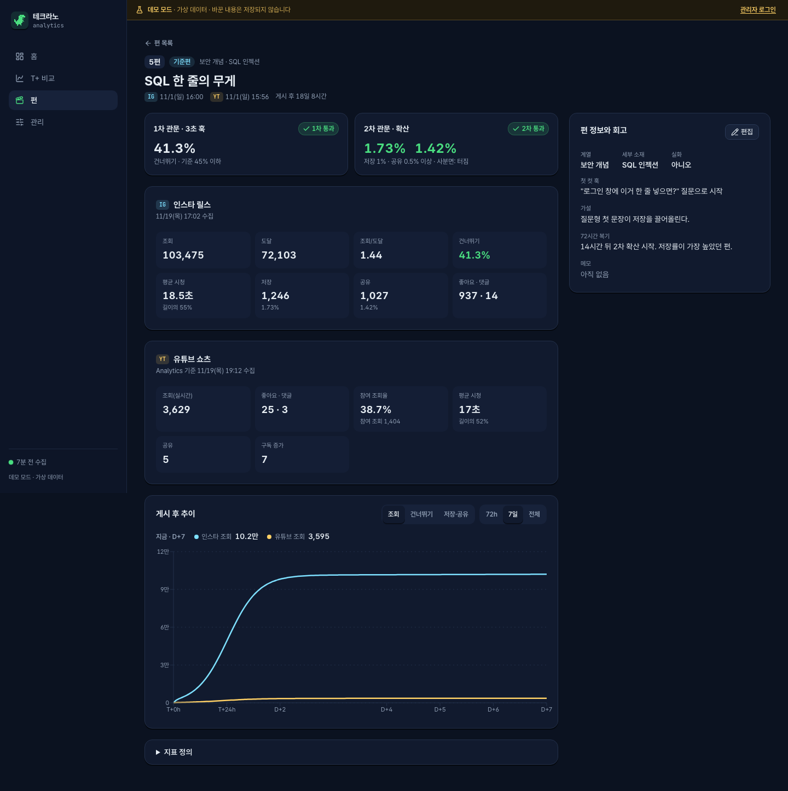
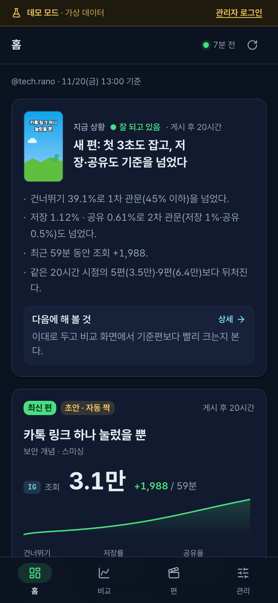
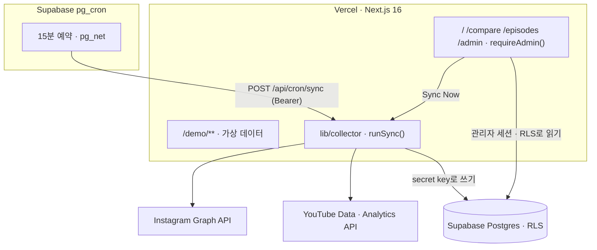

# 테크라노 애널리틱스

1인 IT·보안 숏폼 채널 **@tech.rano**의 인스타 릴스와 유튜브 쇼츠 성과를 게시 직후부터 15분마다 쌓아, 실제 운영 기록에서 찾은 **2단계 알고리즘 관문**으로 읽는 대시보드입니다.

- 실데이터는 관리자만 봅니다. 로그인 화면의 **게스트 데모 체험하기**를 누르면 가상 데이터로 모든 화면과 동작을 써 볼 수 있습니다(`/demo`).
- 운영 비용 월 0원: Vercel Hobby, Supabase Free(pg_cron 예약 포함).
- 이 레포에는 실제 수치와 메모가 들어 있지 않습니다. 데모 데이터는 코드가 만든 가상 값입니다.

| 홈 | T+ 비교 |
|---|---|
|  |  |

| 편 상세·회고 | 폰 |
|---|---|
|  |  |

## 무엇을 보나: 2단계 관문

| 관문 | 기준 | 근거 |
|---|---|---|
| 1차 · 3초 훅 | 건너뛰기 ≤ 45% | 첫 3초 이탈이 높은 편은 초반에 멈췄다 |
| 2차 · 확산 | 저장/도달 ≥ 1.0%, 공유/도달 ≥ 0.5% | 저장·공유가 이만큼 나온 편만 크게 퍼졌다 |

- **홈**: 채널 합계, 최신 편의 최근 1시간 변화와 같은 시점의 기준편 비교, 관문 사분면(터짐 · 훅 부족 · 저장동기 부족 · 전면개선).
- **T+ 비교**: 날짜가 아니라 게시 후 경과 시간으로 줄을 맞춰 여러 편의 곡선을 겹쳐 본다. 실측이 적은 편은 실측 위치에만 점을 찍는다.
- **편 상세**: 인스타·유튜브 지표, 관문 판정, 추이, 첫 컷 훅·가설·72시간 복기 메모.
- **관리**: Sync Now, 수집 로그, 수집기가 자동으로 만든 초안 확정·합치기, 기준편 지정.

## 구조



- 크론, Sync Now, 로컬 CLI가 같은 `runSync()`를 씁니다. Meta·Google 토큰은 Vercel에만 있고, DB 예약은 엔드포인트를 부르기만 합니다(호출용 비밀값은 Supabase Vault). GitHub Actions 예약은 켠 뒤 몇 시간씩 한 번도 돌지 않아 DB 예약으로 바꿨습니다.
- 게시 후 6시간까지는 15분, 72시간까지는 1시간, 그 뒤로는 점점 간격을 늘려 스냅샷을 찍습니다. YouTube Analytics는 집계가 24~48시간 늦어 게시 20시간 뒤부터 묻습니다.
- 새 릴스·쇼츠가 올라오면 초안 편을 만들고, 12시간 안에 올라온 인스타·유튜브 초안은 자동으로 짝짓습니다.
- 한 플랫폼이 실패해도 다른 쪽은 끝까지 수집하고(`partial`), 오류 메시지는 토큰을 가린 뒤 저장합니다.

## 보안

| 층 | 무엇 | 위치 |
|---|---|---|
| 1 | proxy: 세션 갱신, 로그인 안 한 요청을 `/login`으로 | `src/proxy.ts` |
| 2 | `requireAdmin()`: 서명을 검증한 JWT의 `app_metadata.app_role`과 이메일 확인. 실데이터 조회와 모든 Server Action이 거친다 | `src/lib/auth/guard.ts`, `src/lib/data/live.ts` |
| 3 | RLS: anon 권한 없음, 관리자 claim이 없으면 0행. 뷰는 `security_invoker` | `supabase/migrations/*_security.sql` |

- **데모 분리**: `/demo/**`와 데모 데이터 코드는 Supabase·인증·수집 모듈을 import할 수 없습니다(ESLint `no-restricted-imports`). e2e가 데모 화면에서 Supabase 요청 0건을 확인합니다.
- Supabase 익명 로그인은 쓰지 않습니다. 익명 사용자도 `authenticated` 역할이라 정책 실수 하나로 데이터가 열릴 수 있습니다.
- `scripts/scan-secrets.sh`가 추적 파일과 브라우저 번들에서 토큰·개인정보 패턴을 찾습니다(CI).

## 데이터 모델

`episodes`(편 메타·연결 키) · `ig_media` / `yt_videos`(게시물 목록) · `ig_snapshots` / `yt_snapshots`(시점별 누적값) · `sync_runs`(수집 로그). 스냅샷은 플랫폼 ID에 붙어 있어 편을 다시 연결해도 옮기지 않습니다. 게시 후 경과 시간은 뷰에서 계산합니다(예약 공개 영상은 공개되며 게시 시각이 바뀌므로 저장하지 않음).

## 개발

```bash
npm install
npm run dev            # http://localhost:3000/demo 는 설정 없이 바로 열린다
npm test               # 단위 + DB(PGlite로 마이그레이션·RLS 검증)
npm run e2e            # next build 후. 데모·접근 차단·헤더
npm run lint && npm run typecheck && npm run scan
```

실데이터 연결과 배포 순서는 [docs/SETUP.md](docs/SETUP.md), 설계 전체는 [docs/PLAN.md](docs/PLAN.md)에 있습니다.

| 명령 | 하는 일 |
|---|---|
| `npm run probe` | 인스타·유튜브 자격 증명 확인(값은 출력하지 않음) |
| `npm run sync -- [--force] [--dry-run] [--discover-all]` | 수집 한 회차 |
| `npm run sync -- --memory-readme <편 목록 표>` | DB 없이 실제 API만 확인 |
| `npm run seed -- --readme <편 목록 표> [--apply]` | 편 시드 |
| `npm run import-points -- --file <json> [--apply]` | 수집 전 손으로 기록한 수치 넣기 |
| `npm run verify-rls [-- --anon-only]` | 배포된 DB에서 접근 차단 확인 |

## 크레딧

- 글꼴: [Pretendard](https://github.com/orioncactus/pretendard) (SIL OFL 1.1, `src/app/fonts/PretendardVariable.LICENSE.txt`), JetBrains Mono.
- UI: shadcn/ui(Radix), 차트: Recharts.
